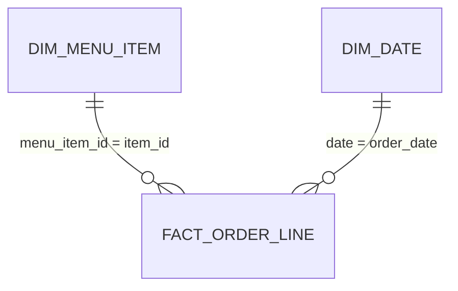

# 📊 Restaurant Order Analysis: Tableau & Power BI kit

Everything needed to rebuild this project as a Power BI and Tableau dashboard in under an hour: model-ready data, ready-to-paste DAX measures and Tableau calculated fields, a matching colour theme, a page-by-page layout, and the exact numbers your finished dashboard should show.

> **Interactive web version:** [scarface96.github.io/Restaurant-Order-Analysis](https://scarface96.github.io/Restaurant-Order-Analysis/). The kit uses the same cleaned data, so the numbers will match.

## What's in this folder

| File | What it is |
|---|---|
| `data/fact_order_line.csv` | one row per item ordered: order id, date, time, hour, item id, `missing_item` flag for the 137 lines with no item |
| `data/dim_menu_item.csv` | one row per menu item: item name, cuisine, price |
| `data/dim_date.csv` | one row per trading day: weekday, month, week start |
| `powerbi/measures.dax` | Every DAX measure and calculated table, with its number format |
| `powerbi/theme.json` | Report theme in the portfolio's teal-and-amber colours |
| `tableau/calculated_fields.md` | Every calculated field, plus how to connect the tables |
| `tableau/Preferences.tps` | The same colours as Tableau palettes |
| `kpis.json` | Headline numbers, for checking your build |
| `build_bi.py` | Regenerates everything here from the repo's own cleaning code: `python -m bi.build_bi` |

## Data model

A star schema: one fact table, small lookup tables around it, single-direction many-to-one relationships.

## Dashboard design

Canvas 1280 × 720. Light page background, white cards, teal for the main series, amber to highlight, red only for bad news.

### Page 1: Trading overview
*How busy is the restaurant, and when?*

- KPI cards: Revenue · Orders · Average Order Value · Items per Order
- Line chart: Revenue by dim_date[date] (daily) with a 7-day average trend line
- Matrix heatmap: rows dim_date[weekday] (sort by weekday_no), columns fact_order_line[order_hour], values Orders, conditional colour
- Bar chart: Revenue by dim_menu_item[category]

### Page 2: Menu performance
*Which dishes earn their place on the menu?*

- Scatter: x = price, y = Items Sold, details = item_name, legend = category, size = Revenue
- Bar chart: Items Sold by item_name, top 10 and bottom 10 (two visuals with Top N filters)
- Table: item_name, category, price, Items Sold, Revenue, Revenue Share

### Page 3: Basket behaviour
*How big are orders?*

- Column chart: count of Basket[order_id] by Basket[items]
- Cards: Items per Order · share of orders with 5+ items
- Bar chart: Revenue by category for orders with more than 12 items (filter on Basket[items])

## Build it in Power BI

1. **Get data → Text/CSV** and load each file in `bi/data/`. Check that date columns come in as *Date* and IDs as *Whole number* or *Text*.
2. **Modeling → New table** for each calculated table at the top of `powerbi/measures.dax`.
3. In **Model view**, create the relationships (many-to-one, single direction): `fact_order_line[item_id]` → `dim_menu_item[menu_item_id]`; `fact_order_line[order_date]` → `dim_date[date]`.
4. Select `dim_date` → **Table tools → Mark as date table** → `date`.
5. **Home → Enter data**, name the table `_Measures`, load it, then add each measure from `powerbi/measures.dax` and set the format given above it.
6. **View → Themes → Browse for themes** → `powerbi/theme.json`.
7. Build the pages above. Add a title text box on each page with the question it answers.
8. Check your cards against **Check your numbers** below.
9. Save as `Restaurant Order Analysis.pbix` in the repo root.

## Build it in Tableau

1. Copy `tableau/Preferences.tps` to `Documents/My Tableau Repository/` (or merge its palettes into the one there) and restart Tableau.
2. Connect the data as described at the top of `tableau/calculated_fields.md`.
3. Create the calculated fields in that file.
4. Build one sheet per chart above, then a dashboard per page at 1280 × 720 (Fixed size). Use the *Tony Mulunda* palettes for colour.
5. Check your BANs against **Check your numbers** below.
6. **File → Save to Tableau Public**, then save the packaged workbook (`.twbx`) in the repo root.

## Check your numbers

Your finished dashboard (no filters applied) should show:

| Measure | Value |
|---|---|
| Revenue | 159,217.90 |
| Orders | 5,370 |
| Items sold | 12,097 |
| Average order value | 29.65 |
| Items per order | 2.25 |
| Order lines with no item (data gap) | 137 |
| Menu items | 32 |
| Most ordered item | Hamburger (622) |
| Date range | 2023-01-01 to 2023-03-31 |

If a number is off, the usual causes are a relationship pointing the wrong way, a date column loaded as text, or a missing join.

## Notes on the data

- 137 order lines have no item in the source data. They are kept so that order counts match the SQL, but they add no revenue. Filter `missing_item = 0` on any item-level visual.

## Publish and show it off

- **Tableau Public:** after saving, copy the share link and add it to the main README next to the live web report.
- **Power BI:** *Publish to web* needs a work or school account. Without one, add a screenshot of each page to `docs/images/` and link the `.pbix` from the README.
- Take a 1280 × 720 screenshot of page 1 and put it at the top of the main README, so it's the first thing a recruiter sees.
